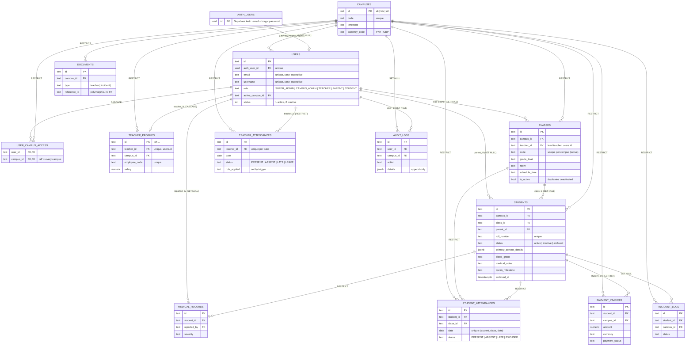
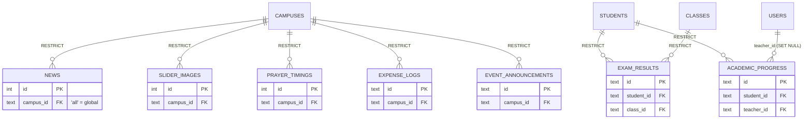

# Entity-relationship diagram — Misbah-ul-Quran IMS

State after migrations `20261126_01` … `20261126_04`. Column lists show keys and the
fields that matter for relationships; see [SCHEMA.md](SCHEMA.md) for every column.

Labels on each relationship give the `ON DELETE` rule.

## Core model

## Content and reserved tables

`news`, `slider_images` and `prayer_timings` are public (readable while signed out).
`expense_logs`, `event_announcements`, `exam_results` and `academic_progress` are reserved:
the tables exist with keys and RLS, but no app feature writes to them yet.

## Reading the diagram

- **Identity:** a person signs in through Supabase Auth (`auth.users`). Their app profile is one `users` row,
  and `user_campus_access` says which campuses they may see. Teachers also have one `teacher_profiles` row.
- **History is protected:** campuses, students and teachers with history cannot be hard-deleted
  (`RESTRICT`). The app archives students and deactivates teachers instead.
- **Logs keep their content:** when a user is removed, their audit and medical-report rows stay with `user_id = NULL`.
